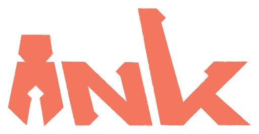

<div align="center">
    
    <h3>Roblox UI beyond the instance tree</h3>
    <a href="https://teamfireworks.github.io/ink"><kbd> <br/> Documentation <br/> <kbd/></a>
    <a href="https://github.com/teamfireworks/ink/releases"><kbd> <br/> Releases <br/> <kbd/></a>
    <br/>
    <a href="https://emberpm.dev/package/teamfireworks/ink"></a>
    <a href="https://ink.teamfireworks.org"></a>
    <a href="./LICENSE"></a>
</div>

<hr/>

Ink is an immediate-mode UI library for Roblox. Build composites from simple
shapes, laid out with plain functions, and animate anything, all without an
instance tree.

```luau
local function button(s: ink.Scope, label: string, on_click: () -> ())
	local content = ink.pad_xy(ink.text(label, STYLE, WHITE), 16, 8)
	local hot, spot = ink.hotspot(s:key("hit"), content.bounds)

	if hot.clicked then
		on_click()
	end

    local bg_color = if hit.state == Enum.GuiState.Hover then LIGHT else DARK
	local bg = ink.tween(s:key("bg"), bg_color, 0.15)

	return ink.compose({ ink.solid(content.bounds, bg), content, spot })
end

local function ui()
    local menu = ink.v_stack({
        button(scope:key("play"), "Play", play),
        button(scope:key("settings"), "Settings", open_settings),
    }, 8, 0.5)

    return ink.align(menu, viewport, 0.5, 0.5)
end
```